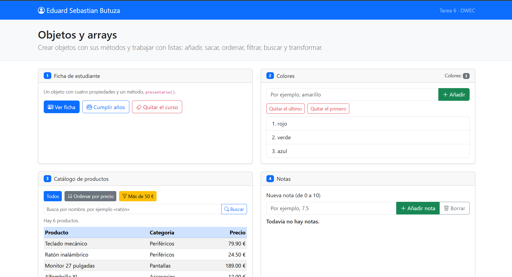
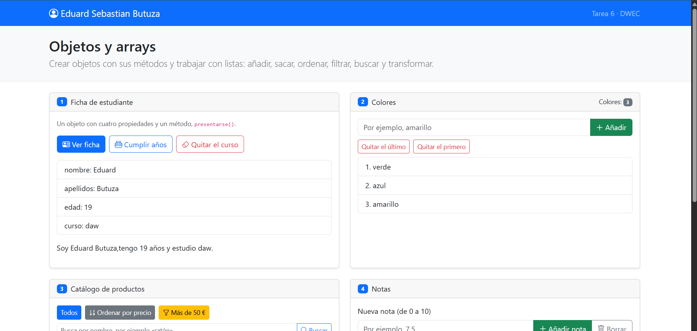
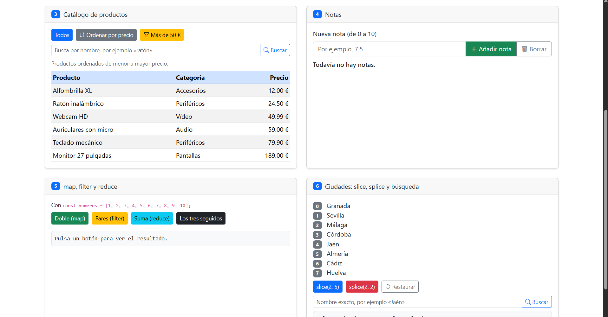
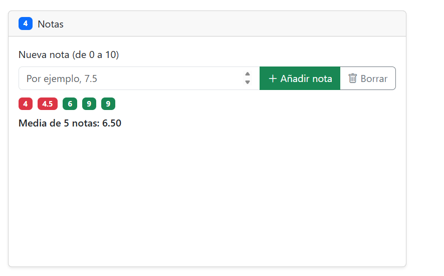
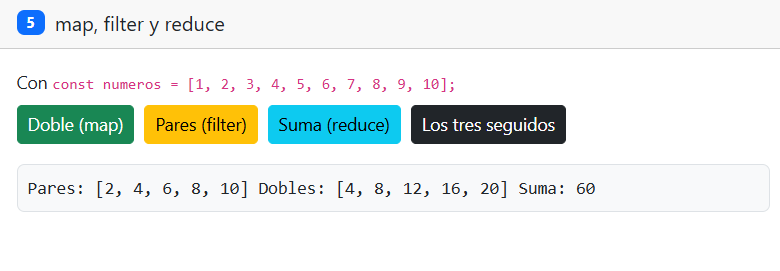
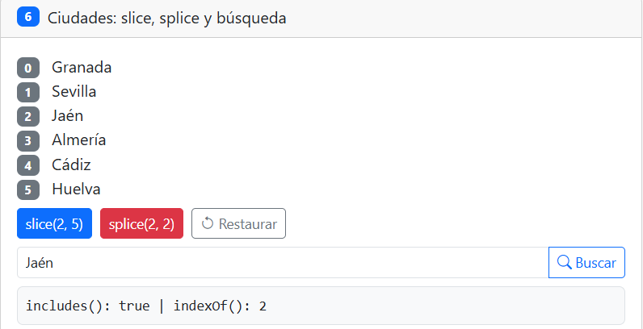

# Tarea 6 · Objetos y arrays

**Autor:** Eduard Sebastian Butuza · Desarrollo Web en Entorno Cliente (DWEC) · 2.º DAW · Curso 2026-27

En esta carpeta está la práctica de objetos y arrays con JavaScript. Para verla, abre `index.html` con **Go Live** y prueba los botones.

## Capturas

### a) La página recién cargada

Al cargar la página aparecen mi nombre en la barra de navegación, los colores iniciales, la tabla con los productos y la lista de ciudades.

### b) Ejercicios 1 y 2: la ficha y los colores

En la ficha cumplí años y mi edad pasó a 19. En los colores usé `push()` para añadir uno, `pop()` para quitar el último y `shift()` para quitar el primero.

### c) Ejercicio 3: el catálogo ordenado por precio

La función de comparación resta un precio al otro para ordenar los productos de menor a mayor. Ordené una copia para mantener el array original sin cambios.

### d) Ejercicio 4: las notas y la media

Añadí cinco notas: 4, 4.5, 6, 9 y 9. Hay notas suspensas y aprobadas. La media es 6.50.

### e) Ejercicio 5: los tres métodos seguidos

`filter()` selecciona los números pares. `map()` calcula sus dobles y `reduce()` suma esos dobles. El resultado final es 60.

### f) Ejercicio 6: después de splice y de buscar una ciudad

`splice(2, 2)` quitó Málaga y Córdoba. Después busqué Jaén: `includes()` devuelve `true` e `indexOf()` devuelve 2, porque al quitar esas ciudades Jaén cambió de posición.

## Reflexión

He aprendido que `push()`, `pop()`, `shift()` y `splice()` cambian el array original.  
`slice()` obtiene una parte del array y deja el original igual.  
`map()` y `filter()` devuelven arrays nuevos.  
`reduce()` calcula un resultado, como una suma.  
En el ejercicio 6, `splice()` quitó ciudades y `slice()` solo obtuvo una parte.  
En el ejercicio 3 ordené una copia porque ordenar el array original lo cambiaría.

## Fuentes

- [MDN: Array](https://developer.mozilla.org/es/docs/Web/JavaScript/Reference/Global_Objects/Array)
- [MDN: Trabajar con objetos](https://developer.mozilla.org/es/docs/Web/JavaScript/Guide/Working_with_objects)

## Uso de IA

He usado ChatGPT para resolver dudas sobre JavaScript y completar algunas funciones